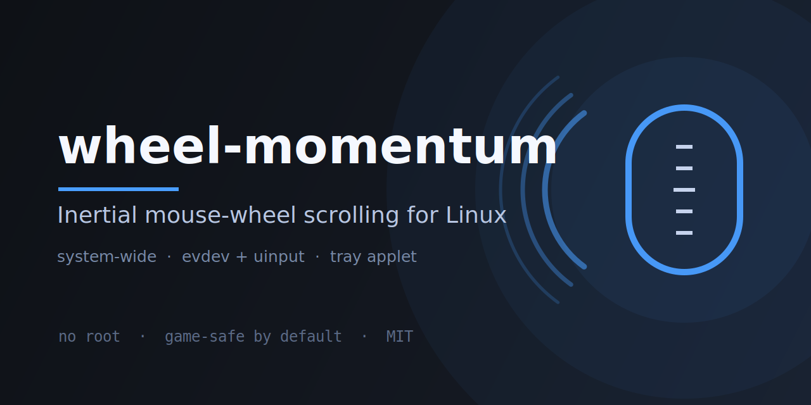

<p align="center">
  
</p>

# wheel-momentum

**Inertial (momentum) scrolling for the mouse wheel on Linux — the same buttery
glide your touchpad has, in every application.**

[](https://github.com/ferhatkaplan-dev/wheel-momentum/releases)
[](LICENSE)
[](#requirements)
[](https://www.python.org/)
[](#permissions)

```bash
git clone https://github.com/ferhatkaplan-dev/wheel-momentum.git
cd wheel-momentum && ./install.sh
```

A scroll wheel only sends discrete detents: no velocity, no "release" event,
so browsers and toolkits can only animate each step. **wheel-momentum** sits
below the applications and turns every detent into a decaying stream of
high-resolution wheel events, which the compositor renders as smooth pixel
scrolling that keeps gliding and slowly settles after you stop turning.

```
mouse ──(read)──▶ wheel-momentum ──uinput (REL_WHEEL_HI_RES)──▶ compositor ──▶ app
                        │
                        └─ exponential decay: 120 units = 1 detent
```

It runs in one of two modes:

| Mode | Device | Feel | Safe for games? |
|---|---|---|---|
| `additive` *(default)* | Only read, never taken over | Detent + smooth tail | **Yes** — input can never be lost |
| `grab` | Taken over (`EVIOCGRAB`) and cloned 1:1 | Fully smooth from the first pixel | No — apps that read `/dev/input` directly (Wine/Proton, SDL raw input) stop receiving it |

## Why not just…

| Approach | Limitation |
|---|---|
| `imwheel` | X11 only; replays coarse detents, so Wayland and pixel-smooth motion are out |
| Browser extension | works inside one browser, nowhere else |
| `libinput` scroll factor / kinetic settings | change touchpads, not mouse wheels |
| App-level "smooth scrolling" toggles | one app or toolkit at a time |

**wheel-momentum** works at the evdev layer, so every application — terminal,
editor, browser, Electron app, GTK/Qt — gets the same glide, on Wayland and X11.

## Features

- Works **system-wide** — terminals, editors, browsers, Electron apps, GTK/Qt.
- No root daemon: runs as your user, only needs `/dev/uinput` write access.
- Touchpads and tablets are never touched (they have `ABS_X`, so they're skipped).
- Tray applet with an enable switch, presets and a settings panel (StatusNotifierItem).
- Two `systemd --user` units, no extra background services.
- **Fail-safe by design:** the default mode never takes the device; the grab is
  released by the kernel if the daemon dies; a hung event loop is killed by the
  systemd watchdog; a forwarding error hands the device straight back to the OS.

## Requirements

- Linux with `libinput`-based input stack. Tested on **Sway/wlroots 0.19**
  (Wayland). KWin/Mutter should work; X11 via `xf86-input-libinput` is untested.
- High-resolution wheel support (`wl_pointer.axis_value120`) for the smooth part:
  wlroots ≥ 0.17, recent KWin/Mutter. Older stacks still scroll, just coarser.
- `python3` + `systemd` (user services) for the installer.
- For the tray: `python-gobject`, `gtk3`, `libayatana-appindicator`, and a
  StatusNotifierItem host (waybar's `tray` module, KDE, GNOME extension, …).
- Read access to `/dev/input/event*` and write access to `/dev/uinput`.

## Install

```bash
git clone https://github.com/ferhatkaplan-dev/wheel-momentum.git
cd wheel-momentum
./install.sh
```

The installer creates a private venv with `python-evdev`, copies the executables
to `~/.local/bin`, installs the two user units and starts them.

## Permissions

Reading input devices needs the `input` group:

```bash
sudo usermod -aG input "$USER"   # then log out and back in
```

Writing `/dev/uinput` is usually already granted by systemd-logind via an ACL
(`uaccess`). If it isn't:

```bash
sudo tee /etc/udev/rules.d/60-uinput.rules >/dev/null <<'EOF'
KERNEL=="uinput", GROUP="input", MODE="0660", OPTIONS+="static_node=uinput"
EOF
sudo udevadm control --reload && sudo modprobe uinput
```

## Usage

Tray icon (blue mouse when enabled, grey slashed mouse when off):

| Item | Effect |
|---|---|
| **Enabled** | starts/stops and enables/disables the daemon |
| **Presets ▸** | Soft / Balanced / Firm / Instant, applied immediately |
| **Settings…** | panel with sliders and the *Never take the device* switch |
| **Start on login** | autostart for the tray applet |
| **Quit** | exits the applet (daemon keeps running) |

Open the panel from a terminal or a keybinding:

```bash
wheel-momentum-tray --show
# sway: bindsym $mod+Shift+w exec wheel-momentum-tray --show
```

CLI:

```bash
systemctl --user status wheel-momentum       # state
systemctl --user reload wheel-momentum       # apply config edits
systemctl --user stop wheel-momentum         # mouse returns to native instantly
journalctl --user -u wheel-momentum -f       # live log ("attached: ..." lines)
wheel-momentum --selftest                    # verify math + uinput emission
wheel-momentum --probe 5                     # read-only: what do your devices send?
```

## Configuration

`~/.config/wheel-momentum/config.json`. The tray applies changes instantly;
from a terminal run `systemctl --user reload wheel-momentum`.

| Key | Default | Meaning |
|---|---|---|
| `mode` | `"additive"` | `additive` = never take the device (safe), `grab` = full takeover (smoother) |
| `multiplier` | `1.4` | Total travel per detent. `1.0` = exactly one detent, `1.8` = strong inertia |
| `friction` | `0.93` | Damping per 16.7 ms. `0.90` long glide, `0.96` stops quickly |
| `hz` | `125` | Emission rate. `200` is smoother, slightly more CPU |
| `max_velocity` | `4.0` | Velocity ceiling (hi-res units/ms) |
| `stop_velocity` | `0.02` | Below this the animation ends |
| `exclude` | `[]` | Device name substrings to ignore, e.g. `["jogdial"]` |
| `include` | `[]` | If set, only these device names are handled |

Presets shipped with the tray:

| Preset | multiplier | friction |
|---|---|---|
| Soft | 1.9 | 0.905 |
| Balanced | 1.4 | 0.93 |
| Firm | 1.1 | 0.96 |
| Instant | 1.0 | 0.99 |

## Notes and tuning

- **Mode.** `additive` (default) cannot break any application: the wheel keeps
  working natively and the glide is added on top. Switch to `grab` (tray →
  *Never take the device* off, or `"mode": "grab"`) if you want the last bit of
  smoothness and never game with raw input.
- **Games and raw input.** Wine/Proton, some native games and remote-desktop
  tools open `/dev/input/event*` themselves. In `grab` mode they receive nothing
  while the daemon holds the device (clicks and wheel included). Keep the
  default `additive` mode, or turn the tray switch off before playing.
- **Double momentum in Firefox/Zen.** Firefox applies its own kinetic scrolling
  to touchpad-like pixel input. If the glide feels too strong, lower
  `multiplier` to `1.0` or set `apz.gtk.kinetic_scroll.enabled` to `false` in
  `about:config`.
- **Devices.** Like touchpads, anything with `ABS_X` (tablets, touchscreens) is
  skipped. Multi-device setups are fine: each matching mouse is handled on its own.
- **Virtual device.** In `additive` mode a pointer named *Wheel Momentum wheel*
  appears in your input list; it carries only momentum events. In `grab` mode
  each mouse gets a 1:1 clone with the original name.

## Troubleshooting

| Symptom | Check |
|---|---|
| Nothing happens | `journalctl --user -u wheel-momentum -f` — did it print `attached: <your mouse>`? |
| Mouse acts up | `systemctl --user stop wheel-momentum` returns everything to native instantly |
| Clicks/scroll lost in a game | you are in `grab` mode — switch to `additive` |
| Settings seem ignored, service `failed` | run `systemctl --user reset-failed wheel-momentum` (the tray does this on enable) |
| No smooth scrolling in one app | that app may ignore high-resolution wheel events; try `hz` 200 |
| No tray icon | your bar needs a StatusNotifierItem host (waybar's `tray` module) |
| "uinput is not writable" | see [Permissions](#permissions) |
| Tray window tiled | add `for_window [app_id="wheel-momentum-tray"] floating enable, move position center` to your sway config |

## Uninstall

```bash
./uninstall.sh          # keeps ~/.config/wheel-momentum
./uninstall.sh --purge  # removes config too
```

## License

MIT
